# OsdagBridge Functional Testing Report

Harish Raghav S | SASTRA University | 11 November 2026


# Chapter 1: Introduction and test setup

## 1.1  Overview

| Case groups | Recorded checks / attempts | New GitHub issues | Supporting comments |
| --- | --- | --- | --- |
| 8 | 14 | 4 | 6 |

I tested default and custom materials, repeated designs in one session, saved-input reloads, additional-input persistence and a skew bridge. The application produced useful results, CAD and plots, but several input and display paths did not preserve or represent the intended data correctly.

I found four problems that I reported as new issues: Save Input resets the thickness values, the end-diaphragm tab shows cross-bracing results, support-reaction values disagree within the same screen, and the runtime crash-barrier width differs from my input. I included the reproduction steps and relevant source code in each issue.

Throughout this report, I have kept successful execution separate from the engineering result. A run can finish and display its outputs while still failing a design check. The completed cases reviewed here contain failed engineering checks, so I have not described them as safe bridge designs.

Repository: [github.com/HR5206/OsdagBridge](https://github.com/HR5206/OsdagBridge) Source revision recorded from T03 onward: d74f56dd7f22925fb8148cabf5740ed8d1e39ff3

## 1.2  Method and environment

I used the desktop application for the manual tests and retained original screenshots, saved OSI inputs and generated reports. From T03 onward, a recorder captured input/output dictionaries around the core design call, selected runtime properties, exceptions, timing and source metadata.

| Evidence layer | What I used it to check |
| --- | --- |
| UI screenshots and interaction notes | Entered values, visible outputs, validation warnings, CAD rotation and opening plots. |
| Saved .osi files | Serialization and reload fidelity; complete saved parameter combinations. |
| Before/after JSON and runtime objects | Actual inputs supplied to Design, result changes and selected material/geometry propagation. |
| Generated PDFs | Agreement with the displayed inputs, dictionary outputs and reported design status. |
| Source inspection and isolated checks | Specific explanations for anomalies and proposed regression checks. These are distinct from desktop runs. |

### Environment and provenance

My recorded sessions identify Windows 11 and Python 3.12.16 from conda-forge. The source metadata records commit d74f56d and only untracked evidence directories. I did not capture the installed revision or operating-system release during T01 and T02, so I have not assigned the later revision to those tests.

I used a recorder that wraps the original design method in memory and calls it once. The recorded time covers that call; it excludes later GUI rendering and report export. I have used these timings to describe the runs, not as performance benchmarks. I have included the scripts and source-level checks with the submission.

### Status conventions

PASS means the stated functional check passed. FAIL identifies an observed defect or a software-reported engineering failure, with the category made explicit. Cancelled retains a cancellation outcome without calling it an unexpected crash. Inconclusive means the supplied evidence does not establish the intended scenario.

I compared values in the same units and allowed for rounding in the display. I also checked beyond the selected grade name, because a correct name does not prove that every calculation used the entered properties. I recorded videos separately. The comparisons in this report use my screenshots, saved files and logs; the video files were not independently reviewed for this report.

## 1.3  Complete test register

| Case / date | Action or scenario | Observed outcome |
| --- | --- | --- |
| T01 / 8 Nov | 25 m default-grade baseline | Completed; CAD/plot/PDF generated. Reported engineering FAIL. |
| T02 / 8 Nov | 25 m; custom steel and concrete | Material UI/OSI retention passed; CAD rotation worked. Engineering FAIL. |
| T03-R1 / 10 Nov | First run, span 25 m | Core returned; numerical baseline recorded. |
| T03-R2 / 10 Nov | Unlock/change span to 20 m | Core returned; geometry, plots and numerical outputs changed. |
| T03-R3 / 10 Nov | Unlock/return span to 25 m | Core returned; R1 numerical output reproduced, apart from report timestamp. |
| T04-A1 / 10 Nov | Reloaded custom-material session; run 01 | Cancelled: RuntimeError with cancellation message; 67.24 s. |
| T04-A2 / 10 Nov | Same session; run 02 | Cancelled: same cancellation message; 65.38 s. |
| T04-A3 / 10 Nov | Same session; run 03 | Design error: required material.deck.fck missing; 63.50 s. |
| T05 / 10 Nov | Intended deck 300 / wearing course 75 mm | Inconclusive intended run: saved/results state is 250/50; no captured core call. |
| T05B / 10 Nov | Isolate main Save Input action | FAIL: 300/75 becomes 250/50 in saved input. No design run. |
| T05C / 11 Nov | 300/75, direct Design after dialog Save | PASS for retention and deck output consistency; engineering FAIL. |
| T06-V1 / 11 Nov | Enter span 19 m | PASS: range warning and reset; subsequent screenshot shows 20.0 m. |
| T06-V2 / 11 Nov | Enter skew 16 degrees | PASS: range warning; I confirmed the reset. Exact replacement not captured. |
| T06-D / 11 Nov | 30 m, 9 m width, skew 10; distinct materials | Core returned; CAD rotation/plots worked. UI/data defects and engineering FAIL. |

I completed the three T03 runs in one session. The evidence supports seven completed designs: T01, T02, T03-R1/R2/R3, T05C and T06-D. Five have recorder success records. I have not counted T05 as a verified 300/75 design or combined the functional checks and engineering results into one pass percentage.


# Chapter 2: Inputs and material properties

## 2.1  Geometry and additional inputs

| Case | Span / width / skew | Deck / wearing course | Materials |
| --- | --- | --- | --- |
| T01 | 25 m / 7.5 m / 0 deg | 250 / 50 mm | Steel A; concrete A |
| T02 | 25 / 7.5 / 0 | 250 / 50 | Steel B for all steel; concrete B |
| T03-R1, R3 | 25 / 7.5 / 0 | 250 / 50 | B / B |
| T03-R2 | 20 / 7.5 / 0 | 250 / 50 | B / B |
| T04 source | 25 / 7.5 / 0 | 250 / 50 | B / B before reload loss |
| T05 saved | 25 / 7.5 / null | 250 / 50; UI intended 300/75 | B / B |
| T05B intended | 25 / 7.5 / 0 | 300 / 75; save resets to 250/50 | B / B |
| T05C | 25 / 7.5 / 0 | 300 / 75 | B / B |
| T06-D | 30 / 9 / 10 | 300 / 75 | Girder B; CB C; ED D; concrete B |

For the valid design cases, I used Highway Bridge, Chennai (Minambakkam) (A), Tamil Nadu, Optimized design, no median and no footpath. T05 has no basic-input screenshot and stores a null skew. I have kept that value in the record rather than replacing it with the intended zero.

### Additional inputs and loading

In the executed or saved baseline layout, I found four physical girders with 2.1 m spacing and 1.05 m overhang for the 25 m cases. T06 uses four physical girders, 2.475 m spacing and 1.2375 m overhang, giving an overall width of approximately 9.9 m. The T05 preview shows different values. I have kept those preview values separate from the executed state.

The saved baseline enables Class A, AA wheeled/tracked, 70R wheeled/tracked/bogie, SV and fatigue vehicle flags, with no custom vehicles. Self-weight factor is 1.0, eccentricity 1.2 m, reinforcement Fe 500, top/bottom/side cover 50 mm and fatigue cycles 2,000,000. The exact wind, seismic, member and partial-factor settings remain in each full input file; these were not all varied independently.

I noticed that several saved baseline OSIs contain a wearing-course density of 24 kN/m3, while the UI and captured direct-design inputs contain 25 kN/m3. I have recorded both values. T05C and T06 retain 25 kN/m3 through execution.

## 2.2  Material properties

| Steel property | A: E 350A | B: custom 345/500 | C: custom 275/430 | D: custom 355/510 |
| --- | --- | --- | --- | --- |
| Density, kN/m3 | 76.4 | 77.0 | 77.2 | 78.0 |
| Fy, MPa | 350 | 345 | 275 | 355 |
| Fu, MPa | 490 | 500 | 430 | 510 |
| E, GPa | 200 | 205 | 200 | 210 |
| G, GPa | 76.9 | 78.8 | 76.9 | 80.8 |
| Poisson ratio | 0.30 | 0.30 | 0.30 | 0.30 |
| Thermal, x10^-6 / deg C | 11.7 | 11.7 | 12.0 | 12.1 |

Full custom names: B = custom_steel_345_500; C = custom_steel_275_430; D = custom_steel_355_510. Profile A values are from the T01 saved OSI. Profiles C and D were used in T06 to distinguish cross-bracing and end-diaphragm material paths.

| Concrete property | A: M40 | B: custom_concrete_45_3.5 |
| --- | --- | --- |
| Density, kN/m3 | 24.5 | 25.5 |
| Cube strength fck, MPa | 40 | 45 |
| Mean tensile strength fctm, MPa | 3.0 | 3.5 |
| Secant modulus Ecm, GPa | 33 | 35 |
| Thermal, x10^-6 / deg C | 11.7 | 10.5 |

### What I checked after the run

I compared the T02 OSIs before and after the run and found them identical. The property dialogs also showed my custom values. T03, T05C and T06 retained the material keys through the design call, but the runtime girder density was 78,500 N/m3 instead of the entered 77,000 N/m3. This is why I checked how the values were used, as well as whether they remained in the dictionary.

In T06, I found that all material.* values matched across input-before, input-after and output. The runtime girder E/Fy/Fu and concrete fck/fctm/Ecm also matched after unit conversion. I did not capture the separate member-design material objects. During source review, I found fixed CLI-template material fields that need to receive the properties of the relevant component.


# Chapter 3: Test observations

## 3.1  T01 and T02: baseline and custom materials

T01 and T02 | 8 November 2026

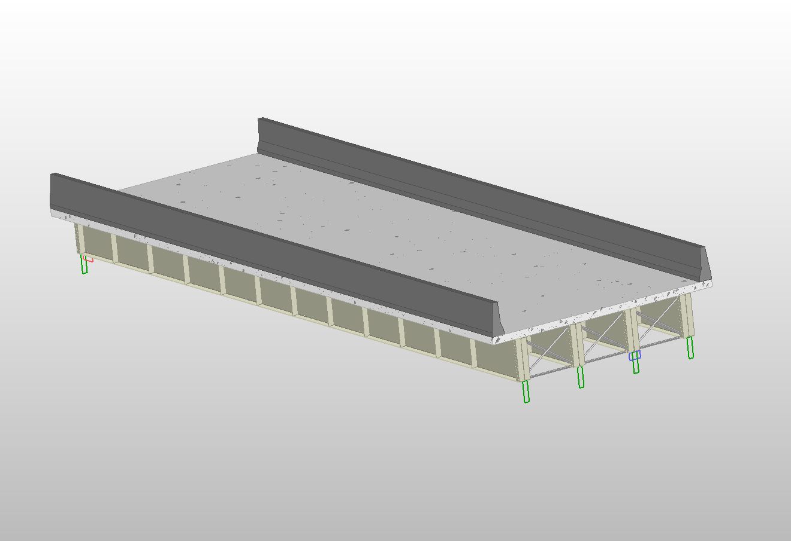

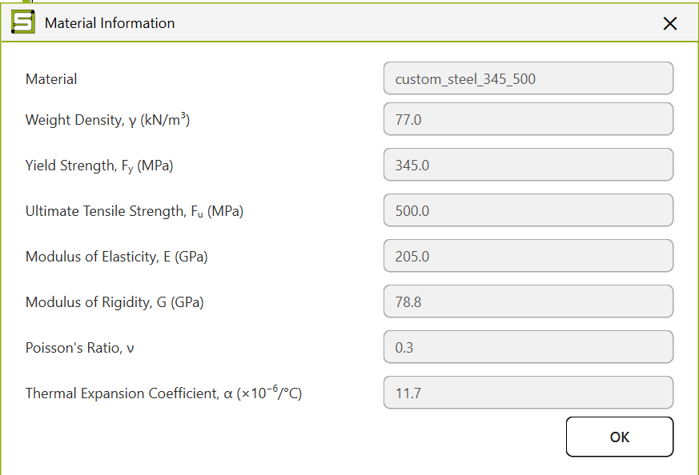

| Check | T01 baseline | T02 custom materials |
| --- | --- | --- |
| Geometry / steel / deck | 25 m / E 350A / M40 | 25 m / custom steel B / concrete B |
| Evidence of completion | Log: analysis complete; 125.99 s | Generated model and PDF; exact duration not captured |
| Input evidence | 576-key saved OSI | 580-key before/after OSIs; identical |
| CAD interaction | Model visible; rotation not attributed to this case | I confirmed rotation |
| Engineering outcome | Report FAIL; max girder UR about 2.00 | Report FAIL; fatigue about 2.00 |
| Selected output comparison | SW moment 97.318 kNm in report; UI 97.32 | Moment resistance 6907.037 kNm vs baseline 6863.47 |

In T01, I noticed that the Girder 1/SW screen showed RB = 14.17 kN in the field but 19.3 kN on the sketch. I found the same type of mismatch in T06, where I had recorder evidence, and reported it in [Issue #73](https://github.com/Nidhikhare12/OsdagBridge/issues/73).

Both runs completed, but I found failed checks in both reports. T01 shows total deflection up to 56.704 mm against a displayed limit of about 41.7 mm. In T02, the comparable maximum falls to 55.321 mm, which is still above the limit. Several material properties changed together, so I cannot attribute this change to one property alone.

I did not capture live backend dictionaries for T01/T02. In their detailed notes, I have separated the UI, saved-file and report evidence and included every saved input in an appendix. I used the recorder in later tests to check runtime values.

## 3.2  T03: three consecutive runs

T03 | One session, 25 m -> 20 m -> 25 m

| Quantity | R1: 25 m | R2: 20 m | R3: 25 m |
| --- | --- | --- | --- |
| Core-call duration, s | 131.52 | 68.41 | 136.86 |
| Runtime span, m | 25 | 20 | 25 |
| Transverse mesh count | 18 | 14 | 18 |
| Girder depth / flange width, mm | 1390 / 420 | 1120 / 340 | 1390 / 420 |
| Visible plot Dy, mm | -3.70 | -2.32 | -3.70 |
| Fatigue ratio | 1.9985 | 2.2152 | 1.9985 |
| Core exception | None | None | None |

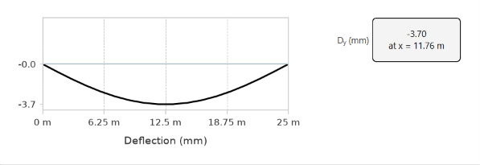

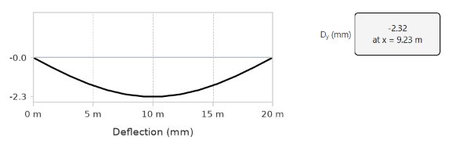

After each completed design, I unlocked the inputs, changed the span and ran again without restarting. The final 25 m run reproduced R1: parsed input-before dictionaries are equal; output dictionaries differ only in the generated timestamp inside design_results.report_text. R2 changes 163 top-level output entries.

This sequence passed: I could change the span and return to the original span without restarting. I have not treated one sequence as proof that every consecutive-run scenario is stable. Changing the span also regenerated suggested sections; 84 before-input fields changed between R1 and R2, not just the span field.

All three designs reported engineering FAIL. My plot screenshots are cropped and do not show the member/load selectors, so I have not labelled their deflection values as a verified total-load case. I used the runtime lengths and plot axes to confirm the geometry update.

## 3.3  T04: saved custom materials after reload

T04 | Fresh-session load exposes a dialog exception and loss of concrete properties

| Concrete key | Source OSI | Re-saved state |
| --- | --- | --- |
| density | 25.5 | 24.5 |
| fck | 45 | null |
| fctm | 3.5 | null |
| ecm | 35 | null |
| thermal | 10.5 | 11.7 |

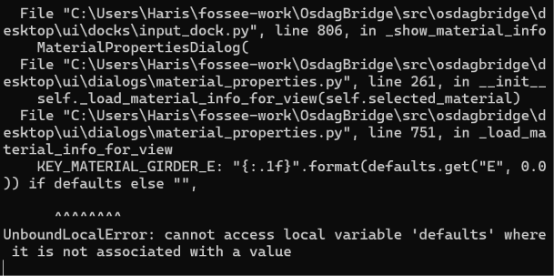

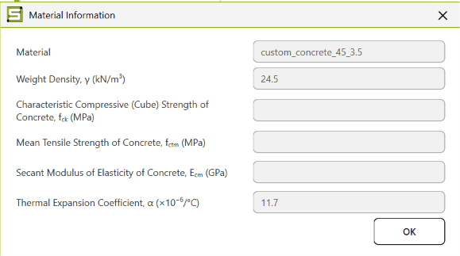

I checked the source OSI against the T03-R3 after-save file and found them byte-identical. After reload, exactly five of the 580 saved values changed, all under material.deck. On the third recorded attempt, Design stopped because material.deck.fck was missing. The first two attempts contain cancellation messages, so I have recorded them as cancelled attempts.

After the steel-info exception, I could still open the deck dialog and attempt Design. I have therefore recorded a dialog callback exception followed by a handled design error, rather than a complete application crash.

### Cause and proposed correction

In the source, I found that loading does not rebuild InputDock._material_custom_fields. Later material priming can replace the saved values with defaults. In material_properties.py:751, a custom-name branch also reaches defaults before assignment. I suggest restoring the complete properties for each component on load, checking incomplete custom materials and initializing the dialog variables safely. Fixing only the exception would not restore the lost data.

[My supporting comment on #19](https://github.com/Nidhikhare12/OsdagBridge/issues/19#issuecomment-6797191826) includes the OSIs, screenshots and run_03 traceback. I have kept these partial failure outputs separate from completed design results.

## 3.4  T05, T05B and T05C: additional inputs

T05, T05B and T05C | Keep the inconclusive attempt and the controlled follow-ups separate

| Case / checkpoint | Deck thickness | Wearing course | Interpretation |
| --- | --- | --- | --- |
| T05 input screenshots | 300 mm | 75 mm | Intended values visible |
| T05 saved/result state | 250 mm | 50 mm | Does not establish the intended run |
| T05B after dialog Save | 300 mm | 75 mm | Values I observed after dialog Save |
| T05B after main Save Input | 250 mm | 50 mm | Reset reproduced in source function |
| T05C input -> output -> PDF | 300 mm | 75 mm | Direct Design retains intended values |

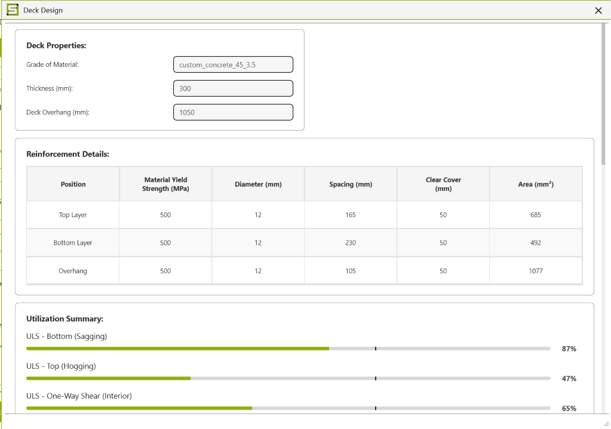

I do not have a numbered recorder run for T05. Its component screenshots show the 250 mm state, so I have not counted it as a successful 300 mm design. I used T05B to isolate the main Save Input action. In T05C, I went directly to Design after saving the dialog and verified 300/75 in the backend and report.

T05C returned in 31.48 s without a captured exception. I compared its deck bottom/top/shear ratios of 0.866/0.470/0.646 with the displayed 87%/47%/65% and found that they matched after rounding. The overall engineering status was still FAIL, with fatigue DCR 2.1776.

## 3.5  T06: validation and skew-bridge run

T06 | Two rejected values, then one valid 30 m / 9 m / 10-degree design

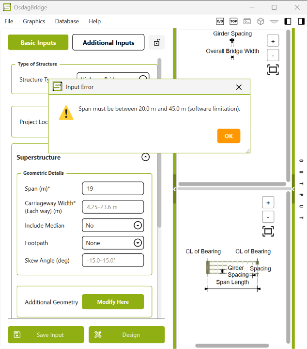

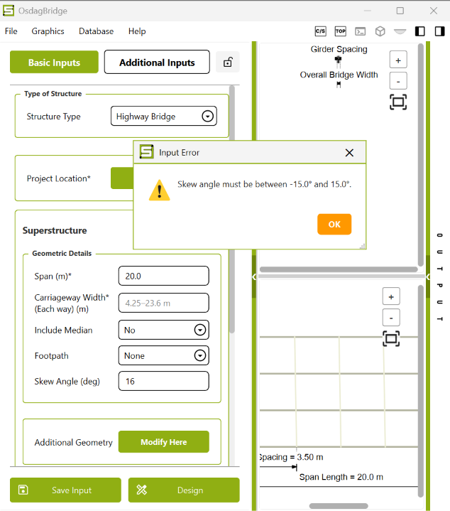

Both warnings appeared and the fields reset. The second screenshot shows the span reset to 20.0 m. The skew replacement value is not captured; its reset is my interaction observation. Neither invalid input was submitted for design.

| Valid-run check | Result |
| --- | --- |
| Runtime span / width / skew | 30.0 m / 9.0 m / 10.0 degrees |
| Deck / wearing course | 300 / 75 mm retained through inputs, outputs and PDF |
| Core call | 152.41 s; engine_returned; no captured error |
| CAD and plots | Generated; rotation and opening plots confirmed |
| Girder 1 / SW plot | Mz 205.54 kNm; Vy 25.19 kN; Dy -5.28 mm |
| Engineering outcome | FAIL; fatigue DCR 1.8924 (189.24%) |

For this case, I selected different grades for the girder, cross bracing and end diaphragm. The before/after inputs each contain 588 keys, and the output contains 1,070. I found 35 input changes related to section normalization and optimized thickness resolution. The geometry and material fields I was checking remained intact.

I confirmed that the CAD model was generated and could be rotated. I did not measure every solid in the model, so the 10-degree input and runtime angle alone do not verify the skew of every rendered component.

## 3.6  Structural-component coverage

| Component | Evidence and comparison | Limit |
| --- | --- | --- |
| Main girders | UI dimensions and SW plots; runtime materials; utilization and report tables | No independent full-code structural recalculation |
| Concrete deck | Custom properties; 250/300 mm outputs; reinforcement and ratio comparisons | Density load path differs from custom input |
| Cross bracing | Selected grade, section, demand/capacity/UR rows and output dictionary | Separate material propagation not verified by UI retention |
| End diaphragms | Distinct output compared to UI in T06 | UI substitutes cross-bracing ratios |
| Intermediate / bearing stiffeners | Custom grade and dimensions visible in T05; report checks reviewed | Not a complete independent design audit |
| Longitudinal stiffeners | Disabled / NA in tested configuration | Enabled configuration not tested |
| Shear connectors / reinforcement | Saved dimensions and report checks retained | No separate connection-detail validation |

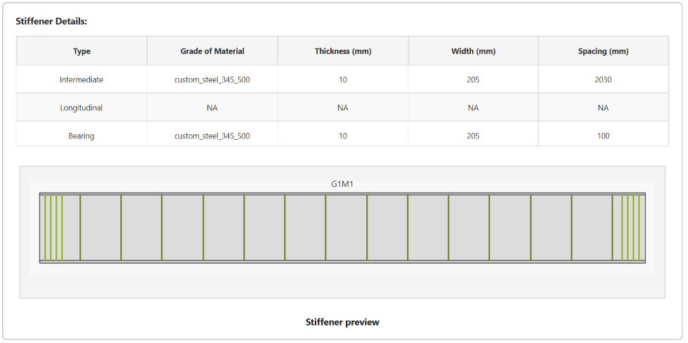

I noticed that the file named 06_end_stiffner_results actually shows the end-diaphragm view. I used the visible content to classify it. The table records what I checked for each component; it does not claim that I verified every design equation.


# Chapter 4: Bugs and code review

## 4.1  Save Input resets thickness values

Published Issue #71 | Input persistence | Reproduced in GUI observations and an isolated source check

[Open issue #71: Save Input thickness reset](https://github.com/Nidhikhare12/OsdagBridge/issues/71)

I saved a 300 mm deck and 75 mm wearing course in Additional Inputs. When I then used the main Save Input button, the saved file contained 250/50. T05C showed that direct Design could retain 300/75. I therefore reported this as a problem in the save path, rather than saying that custom thicknesses never work.

| Checkpoint | Deck, mm | Wearing course, mm |
| --- | --- | --- |
| Values I entered before Save Input | 300 | 75 |
| T05B saved OSI | 250 | 50 |
| Independent defaults-function reproduction | 250 | 50 |

### Source path

[desktop/ui/template_page.py:793](https://github.com/Nidhikhare12/OsdagBridge/blob/d74f56dd7f22925fb8148cabf5740ed8d1e39ff3/src/osdagbridge/desktop/ui/template_page.py#L793) calls solve_extend_basic_input_dict(self.input_dict) before the file dialog. [core/bridge_types/plate_girder/defaults.py:181](https://github.com/Nidhikhare12/OsdagBridge/blob/d74f56dd7f22925fb8148cabf5740ed8d1e39ff3/src/osdagbridge/core/bridge_types/plate_girder/defaults.py#L181) uses an unconditional dictionary update for defaults.

```python
def _update(key, value):
    if input_dict.get(key) in (None, ""):
        input_dict[key] = value
```

I suggest this guard for inserting defaults into user-editable fields without overwriting entered values. The complete fix still needs to separate initialization, derived-layout recomputation and saving. Copying the dictionary before calling the current function would protect the live state but still save the wrong values. Applying the guard to every derived value could also stop necessary recomputation.

### Checks I would run after the fix

For regression testing, I would check that 300/75 survives save, reload and repeated save; missing optional defaults are filled; and dependent geometry is recalculated when its inputs change. I would also check cancelling Save because the mutation occurs before the file dialog opens. I identified that cancellation risk from the source; I did not execute it as a desktop test.

scripts/reproduce_save_reset.py reads a copy of the OSI and calls the original function. Its assertion fails on the tested revision and should pass after a correct fix. No application patch has been applied or validated in this submission.

## 4.2  End-diaphragm results in the wrong tab

Published Issue #72 | UI/output dictionary consistency | G1-G2, Envelope

| Check | CB output / UI | ED output | ED UI |
| --- | --- | --- | --- |
| Diagonal tension | 0.18 | 0.23 | 0.180 |
| Diagonal compression | 0.85 | 0.54 | 0.850 |
| Chord tension | 0.16 | 0.20 | 0.160 |
| Chord compression | 0.74 | 0.47 | 0.740 |

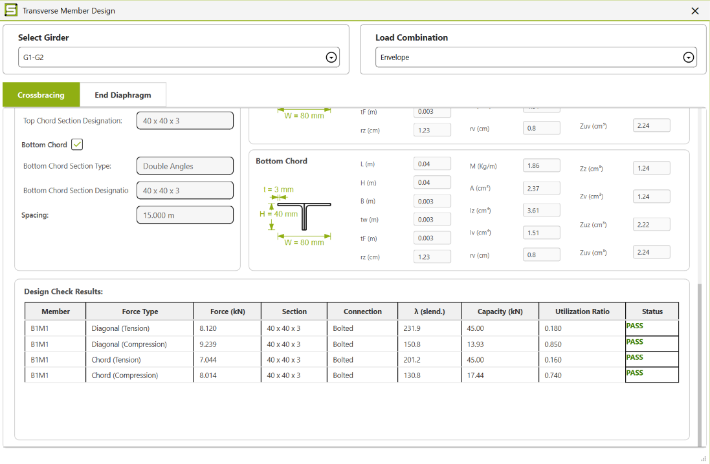

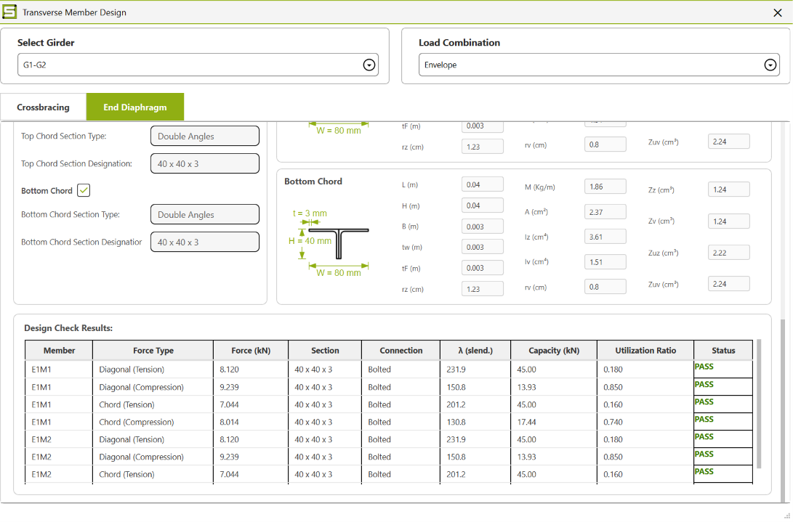

I found different results in the two core dictionaries, but the end-diaphragm screen repeated the cross-bracing values. Comparing the source merge with the screenshots confirmed the substitution. [Open issue #72](https://github.com/Nidhikhare12/OsdagBridge/issues/72) contains full-size evidence.

[desktop/ui/dialogs/transverse_member_design.py:920](https://github.com/Nidhikhare12/OsdagBridge/blob/d74f56dd7f22925fb8148cabf5740ed8d1e39ff3/src/osdagbridge/desktop/ui/dialogs/transverse_member_design.py#L920) starts with a shallow copy of CB results, then attaches ED entries using setdefault. Existing diagonal/chord keys remain CB values. Both tab builders consume that merged map.

```python
self._cb_designs = deepcopy(cb_designs)
self._ed_designs = deepcopy(ed_designs)
# Render each tab with its own design AND force records.
```

I suggest keeping each component's results and governing forces separate when the dialog loads and refreshes. Replacing setdefault with update would only make the other tab wrong. The included AST-based script executes the actual merge statements against the captured output and reproduces all four substitutions. It does not launch Qt or run another analysis.

## 4.3  Support reactions and barrier width

Published issues #73 and #74 | Two independent consistency failures

### Support reactions disagree within one screen

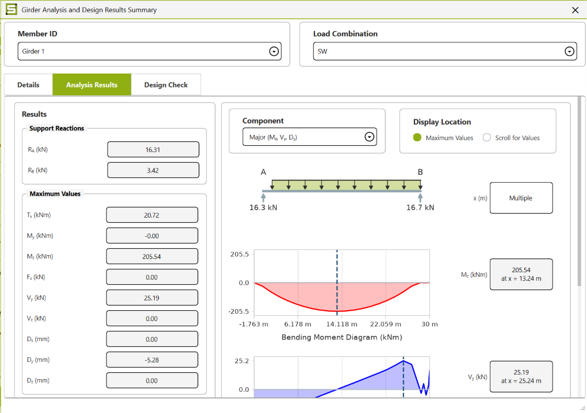

[Issue #73](https://github.com/Nidhikhare12/OsdagBridge/issues/73) traces the field to first/penultimate shear samples in steel_design.py:947, while the sketch calls engine.extract_reactions(). I suggest retrieving the reactions once and using that record for both displays. Missing data should be shown explicitly, and the extractor fallback should be checked against the actual support nodes. I have not independently calculated which displayed reaction is correct.

### Crash-barrier width is replaced in the runtime DTO

| Location | Width |
| --- | --- |
| Input before and after Design | 0.45 m |
| Runtime deck_layout.crash_barrier_width | 0.50 m |

[Issue #74](https://github.com/Nidhikhare12/OsdagBridge/issues/74) identifies _build_dtos() in plategirderbridge.py:1017, which assigns DEFAULT_CRASH_BARRIER_WIDTH. I suggest using the validated KEY_CB_WIDTH value and handling a missing value explicitly. I would check several accepted widths and the dependent layout updates after the change. I confirmed the mismatch, but I have not quantified its structural effect.

## 4.4  Further evidence on material issues

| Property / path | Entered or saved | Runtime / calculation | Status |
| --- | --- | --- | --- |
| Girder E | 205 GPa | 205e9 Pa | Match |
| Girder Fy / Fu | 345 / 500 MPa | 345e6 / 500e6 Pa | Match |
| Girder density | 77 kN/m3 | 78,500 N/m3 | Mismatch |
| Concrete fck / fctm | 45 / 3.5 MPa | 45 / 3.5 MPa | Match |
| Concrete Ecm | 35 GPa | 35 GPa / 35,000 MPa | Match |
| Deck self-weight, 300 mm | 25.5 x 0.300 = 7.65 kN/m2 | 7.36 kN/m2 in deck design | Mismatch |

### Steel density - My supporting comment on #20

I found 77 in the input and output, but _build_material_props() falls back to 78,500 when the custom-grade lookup returns no database density. I suggest reading the validated custom key and converting kN/m3 to N/m3 once. A regression test should expect 77,000 and check self-weight while keeping the section and geometry fixed.

### Deck density - My supporting comment on #41

In T05C, I found another path related to the existing analysis-load issue. The deck-design calculation in deckdesign.py:516 reads a code-table density and multiplies it by 9.81 instead of using my custom weight density. I suggest passing the same validated density into analysis and deck design, without applying another gravity conversion to an input already in kN/m3.

### Component materials - My supporting comment on #43

T06 preserves distinct grades in the input/output dictionaries, but the global material object follows the girder. Source review also finds member-design jobs copied from fixed templates in core/utils/connect.py; load and length are updated without replacing the member material fields. Separate DTOs alone would not fix those payloads. Propagate validated component properties in the downstream solver's supported representation and keep connector materials separate.

I included evidence and proposed regression checks in my comments. I did not run an isolated component-strength sensitivity test or validate a patched material calculation.

## 4.5  Report errors and unresolved observations

| Finding | Evidence | Reporting route |
| --- | --- | --- |
| False girder PASS text | T06 PDF p.6: fatigue UR 1.89, then “Girder design pass”; output status FAIL | Supporting comment on #65 |
| False deck detailing assurance | T05C PDF p.41: 50 mm cover vs 75 mm required, FAIL; sentence says all detailing requirements satisfied | Additional source location in #65 |
| Hardcoded M40 label | T06 PDF p.50: M40 in quantities despite custom fck 45 | Supporting comment on #48 |
| Metres labelled mm | T01/T05: 1.39 mm vs actual 1390 mm; web 0.008 mm vs 8 mm | Existing #66; no new duplicate |
| Railing value changes | Saved 1.4715 kN/m vs design input/report 6.806 kN/m | Existing #64; retained in case notes |
| Empty reaction/load rows | Report tables omit values despite completed designs | Existing #48/#68; not all graphics are missing |

### Proposed report corrections

I suggest generating the pass/fail wording from the evaluated checks and showing an unavailable state when data is missing. The quantity labels should use the selected material name and strength. Units also need to be defined where data enters the report, with pre-design inputs kept separate from optimized results. Multiplying every value by 1000 would give incorrect results for values already in millimetres.

### Observations I could not fully resolve

Force/UR rows: T06 reports 9.239/13.93 kN with UR 0.85, although the displayed ratio is about 0.663. Another summary uses 11.84 kN, consistent with 0.85. The governing force, capacity and utilization need a common source or clearer labelling; this does not establish a wrong capacity equation.

Deflection summaries: T03-R1/R3 per-girder maximum total deflection is 55.321 mm, while the unsuffixed summary uses 22.190 mm. T05C similarly uses 60.608 versus 22.565 mm. Both are retained; member/load-combination mapping is unresolved. I do not choose the smaller value to claim a pass.


# Chapter 5: Coverage and published issues

## 5.1  Requirement coverage and limits

| Screening requirement | Evidence supplied | Practical limit |
| --- | --- | --- |
| Basic and additional inputs | 20/25/30 m spans; 7.5/9 m widths; 0/10-degree skew; 250/300 mm deck; 50/75 mm wearing course | Not every supported geometry or load option was tested |
| Custom steel and concrete | Full custom properties; distinct CB/ED selections; runtime comparisons | Some downstream use fails or remains unverified |
| At least three consecutive designs | T03: one session, 25 -> 20 -> 25; before/after dictionaries and plots | One three-run sequence, not long-duration stress testing |
| CAD and structural plots | Generated models; rotation confirmations; BMD/SFD/deflection views | No dimensional audit of every CAD solid |
| Input/output dictionary comparisons | Recorder snapshots T03/T04/T05C/T06; complete saved OSIs elsewhere | T01/T02 lack live snapshots; T05 intended run inconclusive |
| Steel components and deck | Girder, bracing, diaphragm, intermediate/bearing stiffener and deck evidence | Longitudinal stiffener enabled case not tested |
| Successful and failed cases | Fourteen checks/attempts; cancellations and inconclusive case retained | No verified all-pass bridge case |
| Code-level bug reports | Four original issues and six supporting comments, with source and proposed fixes | Proposed fixes not applied or regression-tested in GUI |
| PDF, repository and supporting files | This report; README, scripts, notes, originals and integrity manifest | Publication and final submission checks are separate |

I have treated this work as functional testing and consistency checking. I have not independently certified the bridge-design equations or compliance with every cited engineering standard. I also have not counted a failed engineering check alone as a software defect. My bug reports concern contradictory displays, lost inputs and values that do not reach the intended calculation.

## 5.2  Published issue register

All links below were verified live under HR5206 on 11 November 2026

| Type | Finding | Live reference |
| --- | --- | --- |
| Original issue | Save Input resets additional thicknesses | [Issue #71](https://github.com/Nidhikhare12/OsdagBridge/issues/71) |
| Original issue | End Diaphragm tab shows CB results | [Issue #72](https://github.com/Nidhikhare12/OsdagBridge/issues/72) |
| Original issue | Reaction field and sketch disagree | [Issue #73](https://github.com/Nidhikhare12/OsdagBridge/issues/73) |
| Original issue | Runtime barrier width ignores input | [Issue #74](https://github.com/Nidhikhare12/OsdagBridge/issues/74) |
| Supporting comment | Reload loss, info-dialog exception | [My supporting comment on #19](https://github.com/Nidhikhare12/OsdagBridge/issues/19#issuecomment-6797191826) |
| Supporting comment | Custom steel density runtime evidence | [My supporting comment on #20](https://github.com/Nidhikhare12/OsdagBridge/issues/20#issuecomment-6797253814) |
| Supporting comment | Additional deck-density calculation path | [My supporting comment on #41](https://github.com/Nidhikhare12/OsdagBridge/issues/41#issuecomment-6797283804) |
| Supporting comment | Distinct materials and fixed job templates | [My supporting comment on #43](https://github.com/Nidhikhare12/OsdagBridge/issues/43#issuecomment-6797318546) |
| Supporting comment | Wrong concrete grade in take-off | [My supporting comment on #48](https://github.com/Nidhikhare12/OsdagBridge/issues/48#issuecomment-6797351975) |
| Supporting comment | False PASS wording, including deck detailing | [My supporting comment on #65](https://github.com/Nidhikhare12/OsdagBridge/issues/65#issuecomment-6797377599) |

I checked open and closed issues and related discussions before preparing new reports. Where an existing issue covered the problem, I added my findings as a comment. The six comments listed above are my additions to those existing reports. I have kept the full URLs, post text and author metadata in issues/github_posts.json and issues/LIVE_ISSUES.md.

All ten posts include file-attachment links. I have also included the same original evidence in this submission so it can be reviewed without relying only on the GitHub attachments. My code changes are suggestions; I have not claimed that they are merged or validated.


# Chapter 6: Reproduction and conclusion

## 6.1  Reproducing the tests and reviewing the evidence

| Folder / file | Contents |
| --- | --- |
| report/ | This PDF and its Markdown text version. |
| case_notes/ | Eight detailed case notes, including historical observations and exact saved-input appendices. |
| evidence/T01 ... T06/ | Original screenshots, OSIs, generated app reports, recorder metadata and run JSON files. |
| scripts/capture_osdagbridge.py | Recorder used for the captured sessions; wraps the original core design call. |
| scripts/reproduce_save_reset.py | Isolated default-expansion reproduction; assertion fails on tested source. |
| scripts/reproduce_ed_merge.py | Actual source merge executed against captured results; no Qt/solver run. |
| scripts/build_report.py | Rebuilds this report from the packaged evidence; requires ReportLab and Pillow and uses standard Helvetica/Courier fonts. |
| issues/ | Links to my published issues/comments and the saved verification snapshot. |
| SHA256SUMS.txt | Checksums for the packaged evidence and documents. |

### How to replay a case

Use the recorded source revision and the repository environment. For an OSI-backed case, open its original saved file in the desktop and follow the relevant case notes. For T05C/T06, no OSI export is claimed: use the full input_before.json as the exact parameter record and enter the documented configuration. Main Save Input is intentionally avoided in these follow-ups because of issue #71.

For the isolated scripts, provide the T05B OSI or the T06 output JSON and the tested source file as described in each script header. These checks reproduce narrow failure mechanisms; they do not constitute additional desktop tests or validate the full solver.

### Evidence handling

I have kept the original evidence filenames and file bytes unchanged. Some case notes say “next test” or “not yet posted” because I wrote them while testing. The issue register in this final report gives the updated reporting status. I have also kept the original application-generated reports unchanged, including the errors discussed here.

### What I would fix first

I would first fix the lost inputs and the incorrect component results shown in the UI. Next, I would check custom-material propagation and report status wording. For regression testing, I would include save/reload, separate component result maps, custom-material payloads and the full three-run change-and-return sequence.

From these tests, I found that the module can complete repeated designs and generate CAD models, plots and reports. I also found problems with saved inputs, custom-material use and consistency between outputs. I have kept both the successful checks and the failures, along with the files needed to repeat them. This gives a clearer record of what worked and what still needs correction.
